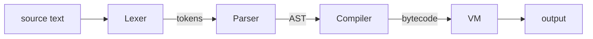

# Sable

[](https://github.com/AgneyaK/sable/actions/workflows/ci.yml)
[](https://agneyak.github.io/sable/playground/)

[](LICENSE)

**Sable** is a small, expression-oriented scripting language with a hand-written
lexer, parser, bytecode compiler and stack-based virtual machine, all in plain
JavaScript with zero dependencies.

It has closures, pattern matching, string interpolation, a pipe operator,
first-class functions, lists, maps and ranges. Its error messages point at the
exact spot that went wrong.

**[Try it in your browser →](https://agneyak.github.io/sable/playground/)**

```rust
fn describe(n) {
  match n {
    0 => "zero",
    1 | 2 | 3 => "a few",
    4..10 => "several",
    x if x < 0 => "negative",
    _ => "lots",
  }
}

fn tally(words) {
  let counts = {};
  for w in words { counts[w] = counts.get(w, 0) + 1; }
  counts
}

let summary = [0, 2, 7, 3, -4, 99, 5]
  .map(describe)
  |> tally();

print("tally: {summary}");
// tally: {zero: 1, "a few": 2, several: 2, negative: 1, lots: 1}
```

## Highlights

- **Everything is an expression.** Blocks, `if` and `match` all produce values,
  and a function returns its last expression.
- **Real closures.** Closures capture variables, not copies. Each loop
  iteration gets a fresh binding, so closures created in a loop behave the way
  you'd expect. This uses the upvalue technique from Lua and clox.
- **Pattern matching** with literals, ranges, `|` alternatives, name bindings
  and `if` guards.
- **String interpolation**: `"total: {price * qty}"`, with any expression
  inside the braces.
- **Pipes**: `data |> parse() |> summarize(10)` means `summarize(parse(data), 10)`.
- **Helpful errors.** Code frames, stack traces and "did you mean" suggestions:

  ```
  runtime error: undefined variable 'cuont'
   --> counter.sb:5:7
    |
  5 | print(cuont);
    |       ^^^^^
    = hint: did you mean 'count'?
  ```

- **A browser playground** with syntax highlighting, a Stop button for runaway
  loops (programs run in a Web Worker), shareable links, and live views of the
  tokens, syntax tree and compiled bytecode.
- **Batteries included.** Around 100 built-in functions and methods on lists,
  strings, maps, ranges and numbers, plus `math`, `try`, and `assert_eq`.

## Getting started

You need [Node.js](https://nodejs.org) 18 or newer. There is nothing to install
beyond that.

```bash
git clone https://github.com/AgneyaK/sable.git
cd sable
node bin/sable.js examples/hello.sb
```

To get a global `sable` command, run `npm link` inside the repo.

```text
sable                      start the interactive REPL
sable <file.sb>            run a file
sable -e <code>            run a snippet
sable disasm <file.sb>     print the compiled bytecode
sable ast <file.sb>        print the syntax tree
sable tokens <file.sb>     print the token stream
```

The REPL keeps state between inputs and continues a line while brackets are
open. It also has a few commands: `:bytecode` shows the compiled bytecode of
each input, `:globals` lists your variables, and `:reset` starts over.

```text
> fn square(x) { x * x }
> (1..=5).map(square)
[1, 4, 9, 16, 25]
```

To run the playground locally:

```bash
npm run playground
```

Then open http://localhost:8080/playground/.

## A quick tour

```rust
// Variables and functions
let name = "Sable";
fn greet(who) { "hello, {who}!" }
let shout = |s| s.upper();
print(greet(name) |> shout());          // HELLO, SABLE!

// Collections
let xs = [3, 1, 2];
let m = { lang: "Sable", tags: ["small", "fast"] };
m.year = 2026;
print(xs.sort(), m.tags[0], m["year"]); // [1, 2, 3] small 2026

// Control flow is made of expressions
let parity = if xs.len() % 2 == 0 { "even" } else { "odd" };
for i, x in xs { print("{i}: {x}"); }
for key, value in m { print(key, value); }
while xs.len() > 0 { xs.pop(); }

// Ranges
print((1..=10).filter(|n| n % 3 == 0)); // [3, 6, 9]
print(range(10, 0, -3) |> list());      // [10, 7, 4, 1]

// Errors can be caught
let result = try(|| error("nope"));
print(result.ok, result.error);         // false nope
```

The full reference is in [docs/LANGUAGE.md](docs/LANGUAGE.md).

## How it works



| Stage | File | What it does |
| --- | --- | --- |
| Lexer | [`src/lexer.js`](src/lexer.js) | Turns text into tokens. Finds the `{...}` holes in interpolated strings. Block comments can nest. |
| Parser | [`src/parser.js`](src/parser.js) | Recursive descent with precedence climbing. Recovers from errors so it can report several at once. |
| Compiler | [`src/compiler.js`](src/compiler.js) | One pass from AST to bytecode. Resolves locals and upvalues at compile time and folds constants. |
| VM | [`src/vm.js`](src/vm.js) | A stack machine with call frames and upvalues for closures. It is re-entrant, so built-ins like `map` can call back into Sable. |
| Stdlib | [`src/stdlib.js`](src/stdlib.js) | Global functions and the method tables for each type. |

You can watch the compiler work with `sable disasm`:

```text
$ sable disasm examples/fib.sb
== fn fib (arity 1, upvalues 0) ==
0000     4:6  GET_LOCAL         1
0002       |  CONST             0       ; 2
0004       |  LT
0005       |  POP_JUMP_IF_FALSE 11      ; -> 0011
0007       |  GET_LOCAL         1
0009       |  JUMP              30      ; -> 0030
0011       |  GET_GLOBAL        1       ; fib
0013       |  GET_LOCAL         1
0015       |  CONST             2       ; 1
0017       |  SUB
0018       |  CALL              1
0020       |  GET_GLOBAL        1       ; fib
0022       |  GET_LOCAL         1
0024       |  CONST             0       ; 2
0026       |  SUB
0027       |  CALL              1
0029       |  ADD
0030    3:11  RETURN
```

[docs/INTERNALS.md](docs/INTERNALS.md) explains the design: how blocks become
expressions on a stack machine, how closures capture variables, and how
errors find their way back to a line of source.

## Examples

| Program | Shows off |
| --- | --- |
| [hello.sb](examples/hello.sb) | A tour of the language |
| [closures.sb](examples/closures.sb) | Counters, memoization, composition |
| [calc.sb](examples/calc.sb) | A tokenizer and recursive-descent parser written in Sable |
| [brainfuck.sb](examples/brainfuck.sb) | A Brainfuck interpreter |
| [game_of_life.sb](examples/game_of_life.sb) | Conway's Game of Life on a wrapping grid |
| [mandelbrot.sb](examples/mandelbrot.sb) | ASCII-art Mandelbrot set |
| [words.sb](examples/words.sb) | Data pipelines with pipes, maps and `group_by` |
| [quicksort.sb](examples/quicksort.sb), [primes.sb](examples/primes.sb), [fizzbuzz.sb](examples/fizzbuzz.sb), [fib.sb](examples/fib.sb) | The classics |

## Tests

```bash
npm test
```

The suite has more than 100 tests covering the lexer, the parser, language
semantics, the standard library, error reporting, and every example program.
It uses a tiny built-in harness, so it runs with no dependencies. The same
tests also run in a browser: open `/test/` on the local server.

## Project layout

```text
bin/sable.js      command-line tool and REPL
src/              the language: lexer, parser, compiler, VM, stdlib
playground/       the browser playground (static files, no build step)
examples/         sample programs
test/             test suite (Node and browser runners)
docs/             language reference and internals guide
```

## License

[MIT](LICENSE)
